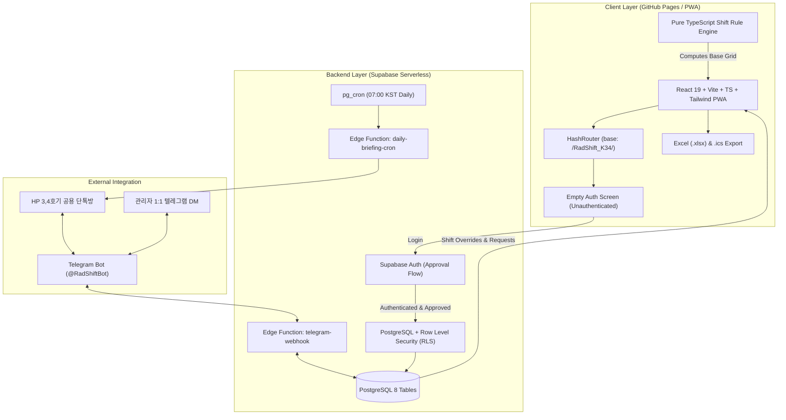
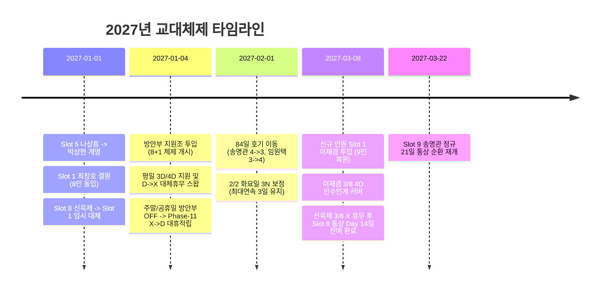

# RadShift_K34 프로그램 상세 명세서 (SRS & System Architecture)

**프로젝트명**: RadShift_K34  
**서비스명**: 한수원 HP 교대근무 관리 (고리 3,4호기)  
**문서 버전**: v1.0.0  
**작성일**: 2026-11-25  
**대상 시스템**: 웹앱(PWA/Desktop/Mobile), Supabase 서버리스 백엔드, 텔레그램 양방향 연동 봇

---

## 1. 시스템 개요 및 목적

한국수력원자력(한수원) 고리 3, 4호기 방사선관리(HP: Health Physics) 교대근무는 원자력 발전소의 특수 보안 시설 및 안전 규정에 부합하는 무결점 일일 커버리지를 보장해야 합니다.
본 시스템은 **2026년 9인 정상 운영 체제(365일)** 및 **2027년 결원에 따른 8+1 방안부 지원 후 9인 원복 시나리오(365일)**에서:
1. **일일 커버리지 오류 0건** (3호기 D/A/N 각 1명, 4호기 D/A/N 각 1명, 총 6명 근무, 3명 휴무)
2. **전원 최대 연속근무 3일 이하**
3. **역순환(Quick Return: N/A 직후 D 투입) 0건**
4. **고정 9슬롯 및 표 행 위치 불변 원칙**
을 수학적·결정론적으로 보장하는 규칙 엔진과, 이를 기반으로 한 실시간 웹앱, 휴가/대근 관리, 텔레그램 봇 자동화 시스템을 제공합니다.

---

## 2. 시스템 아키텍처 및 보안 체계

### 2.1 프론트엔드 (GitHub Pages 정적 배포)
- **프레임워크**: React 19 + Vite + TypeScript + Tailwind CSS
- **라우팅**: `HashRouter` (GitHub Pages `base: '/RadShift_K34/'` 경로 호환)
- **PWA 지원**: `manifest.json`, Service Worker 캐싱, 모바일 홈 화면 추가
- **엑셀/캘린더**: `exceljs` / `xlsx` (월간 매트릭스, 2026 vs 2027 비교표, 8+1 크레딧 정산표, 통상 타임라인), `.ics` iCalendar 동기화
- **절대 보안 원칙**:
  - GitHub 리포지토리가 Public이므로 소스코드, JSON, 공개 번들에 실명, 텔레그램 토큰, Service Role Key 하드코딩 금지.
  - 로그인 및 관리자 승인 전에는 완전 빈 인증 화면(Login UI)만 렌더링.

### 2.2 백엔드 (Supabase 무료 티어)
- **Supabase Auth**: 이메일/비밀번호 + 승인제 (`status = 'pending'` -> 관리자 승인 후 `'approved'`).
- **PostgreSQL RLS (Row Level Security)**: DB 레벨에서 `auth.uid()` 인증 및 `profiles.status = 'approved'` 사용자만 SELECT/INSERT/UPDATE 허용.
- **Supabase Edge Functions (Deno)**:
  - `telegram-webhook`: 텔레그램 명령어, 인라인 버튼 콜백, 제약 검증 및 대근 처리.
  - `daily-briefing-cron`: 매일 오전 07:00(KST) 단톡방 브리핑 및 Supabase 7일 인액티브 방지.
- **익명화 모드**: 관리자 설정에서 '실명 표시 / 슬롯코드(HP-01~HP-09) 표시' 토글.

---

## 3. 핵심 교대근무 규칙 엔진 수학적 명세

### 3.1 기본 인원 및 일일 불변식
- 총 9명: 3호기 교대조 4명 + 4호기 교대조 4명 + 통상 Day(Float) 1명.
- 일일 커버리지:
  - 3호기: D 1명, A 1명, N 1명
  - 4호기: D 1명, A 1명, N 1명
  - 휴무: X 3명 (단, 통상 Day 및 지원조 투입에 따라 휴무 위치 변동)
- 개인 기본 12일 교대 주기 (인덱스 0~11):
  $$\text{CYCLE\_12} = [\text{D}, \text{D}, \text{X}, \text{A}, \text{A}, \text{A}, \text{X}, \text{N}, \text{N}, \text{N}, \text{X}, \text{X}]$$
- 기준일(Anchor Date): **2025-12-29 (월요일, $d=0$)**

### 3.2 고정 9슬롯 및 기준일 초기 상태
근무표의 행 번호(Slot 1~9)는 고정 불변이며 통상 순번을 의미합니다.

| 슬롯 | 기준일 인원 | 기준일 소속 | 기준일 위상 (Phase) | 비고 |
|:---:|:---:|:---:|:---:|:---|
| **Slot 1** | 최창호 | 4호기 | Phase 3 (A) | 2027-01-01 결원 -> 신욱제 임시 대체 -> 2027-03-08 이재겸 복원 |
| **Slot 2** | 손정기 | 4호기 | Phase 6 (X) | 2026-03-02 (84일차) 4호기 -> 3호기 이동 |
| **Slot 3** | 박경욱 | 3호기 | Phase 8 (N) | 기준일 3호기 |
| **Slot 4** | 임원택 | 3호기 | Phase 11 (X) | 기준일 3호기 |
| **Slot 5** | 나상흠 | 3호기 | Phase 2 (X) | 2027-01-01 박상현으로 개명 |
| **Slot 6** | 권재호 | 3호기 | Phase 5 (A) | 2026-05-25 (168일차) 3호기 -> 4호기 이동 |
| **Slot 7** | 이근현 | 4호기 | Phase 9 (N) | 기준일 4호기 |
| **Slot 8** | 신욱제 | 4호기 | Phase 0 (D) | 기준일 4호기 |
| **Slot 9** | 송명관 | 통상 Day | Float | 기준일 통상 Day 담당 (3D/X/4D 패턴) |

- **주간 공백 주기**:
  - $d \pmod 3 == 0$: 3호기 주간 공백(3D) 발생
  - $d \pmod 3 == 1$: 양 호기 공백 없음 (정상 커버)
  - $d \pmod 3 == 2$: 4호기 주간 공백(4D) 발생

### 3.3 21일(3주) 통상 Day 순환 및 일요일 경계일 조정 규칙
- 통상 Day는 항상 월요일 시작 ~ 3주 뒤 일요일 종료 (21일 블록).
- 순번은 Slot 9 -> Slot 1 -> Slot 2 -> ... -> Slot 8 -> Slot 9 로 순환.
- **경계일(블록 20일차 일요일 / 21일차 월요일) 전이 규칙**:
  - **[유형 1: 차기 진입자가 4호기이고 $d \pmod 3 == 0$ 월요일 시작]**:
    - 교대 전날 일요일(블록 20일차): 진입자(당일 Phase 11, 원래 X)가 X -> D로 전환하여 4호기 일요일 공백 커버.
    - 퇴장자: 일요일 4D 면제되어 X-X(토·일 2일 휴무) 후 월요일 D-D로 소속 호기 복귀.
  - **[유형 2: 차기 진입자가 3호기이고 $d \pmod 3 == 0$ 월요일 시작]**:
    - 퇴장자: 일요일 4D까지 완료 후 월요일 X(휴무), 화·수 D-D 복귀.
    - 진입자: 목~토 N-N-N, 일요일 X 후 월요일 3D로 순탄하게 진입.
  - **[유형 3: $d \pmod 3 == 1$ 월요일 시작]**:
    - 월요일 공백 없으므로 일요일 별도 조정 없이 진입자는 월요일 X, 화요일 4D, 수요일 3D로 진입.

### 3.4 84일(4회전·12주) 호기 이동 (3호기 $\leftrightarrow$ 4호기)
- 정상 9인 체제에서 매 84일마다 4->3호기와 3->4호기 이동이 1명씩 교차 발생.
- 2026년 검증 일정:
  - 3/2: 손정기 (4 -> 3호기)
  - 5/25: 권재호 (3 -> 4호기)
  - 8/17: 최창호 (4 -> 3호기)
  - 11/9: 나상흠 (3 -> 4호기)
- **8인 체제(2027년) 중 84일 이동**:
  - 2027-02-01: Slot 9 송명관(4->3), Slot 4 임원택(3->4) 동시 교차 이동.
  - 2/2(화): 송명관의 4연속 야간 방지를 위해 송명관 X, 임원택 3N 1일 보정 투입으로 최대 3연속 근무 철저 보장.

### 3.5 2027년 8+1 방안부 지원 및 9인 원복 시나리오

- **방안부 지원조 일근 기준**:
  - 월~금 평일 출근, 토/일/공휴일 무조건 OFF.
  - 평일 $d \pmod 3 == 0 \rightarrow$ `3D`, $d \pmod 3 == 2 \rightarrow$ `4D`.
  - 평일 $d \pmod 3 == 1$ (여유일): 당일 D 예정 HP 2명 중 대체휴무 크레딧 보유자에게 D->X 대휴 부여 후 방안부가 `3D*` or `4D*` 대체.
  - 주말/공휴일 방안부 OFF: 해당 호기 Phase-11 근무자가 X->D 자동 투입 및 대체휴무 크레딧(+1) 적립.
- **2027년 대한민국 공휴일 (총 24일)**: 신정, 설날 연휴(4일), 3·1절, 노동절 연휴(2일), 어린이날, 부처님오신날, 현충일, 제헌절 연휴(2일), 광복절 연휴(2일), 추석 연휴(3일), 개천절 연휴(2일), 한글날 연휴(2일), 성탄절 연휴(2일).

---

## 4. 데이터베이스 스키마 명세 (Supabase PostgreSQL)

### 4.1 테이블 명세
1. `profiles`: 사용자 계정 및 권한 (`id`, `email`, `display_name`, `alias_code`, `role`, `status`, `slot_no`, `telegram_user_id`, `created_at`)
2. `rotation_slots`: 9개 슬롯 고정 인원 및 효력기간 (`slot_no`, `member_name`, `effective_from`, `effective_to`, `note`)
3. `scenarios`: 8+1 및 9인 시나리오 설정 (`id`, `name`, `mode`, `start_date`, `end_date`, `vacant_slot_no`, `temp_cover_slot_no`, `support_name`, `restore_remaining_days`, `is_active`)
4. `holidays`: 법정공휴일/대체공휴일 DB (`holiday_date`, `name`, `is_substitute`, `year`)
5. `leave_relief_requests`: 휴가 및 대근 신청서 (`id`, `target_date`, `unit_no`, `shift_code`, `requester_id`, `relief_id`, `leave_type`, `comp_type`, `status`, `telegram_message_id`, `approved_by`)
6. `shift_overrides`: 2-Layer 근무표 오버라이드 셀 (`id`, `target_date`, `slot_no`, `member_name`, `orig_code`, `new_code`, `badge_label`, `request_id`, `created_by`, `created_at`)
7. `credit_ledger`: 대체휴무 크레딧 원장 (`id`, `slot_no`, `target_date`, `credit_type`, `delta`, `memo`)
8. `audit_logs`: 관리자 수정 및 승인 감사 로그 (`id`, `actor_id`, `action_type`, `before_json`, `after_json`, `reason`, `created_at`)

### 4.2 Row Level Security (RLS) 정책
- `profiles`: 본인 프로필 조회/수정 가능, 관리자(L3)는 전원 수정 가능.
- 기타 7개 테이블: `profiles.status = 'approved'`인 인증 사용자만 SELECT 가능.
- `shift_overrides`, `audit_logs`: L3 관리자만 INSERT/UPDATE/DELETE 가능.
- `leave_relief_requests`: L2 이상 신청 및 본인 건 수정 가능, L3 관리자 최종 승인 가능.

---

## 5. 실시간 제약조건 검증기 및 추천 엔진

### 5.1 Hard Constraints (위반 시 저장 차단)
1. 3호기(D,A,N), 4호기(D,A,N) 각 1명 미만 커버리지 부족.
2. 역순환(Quick Return): N/A/3N 근무 익일 D/3D/4D 배정.
3. 1인 1일 중복 근무 배정.
4. 방안부 일근 지원조의 주말/법정공휴일/대체공휴일 배정.

### 5.2 Soft Constraints (황색 경고 후 관리자 확인 시 허용)
1. 연속 근무 4일 이상 (`consecutive_days >= 4`).
2. 월간 개인별 근무일 편차 $\pm 2$일 초과 또는 미정산 크레딧 3일 초과.

### 5.3 대근자 Top 3 자동 추천 알고리즘
$$\text{Score} = w_1 \times \text{IsPhase11} + w_2 \times \text{SameUnit} - w_3 \times \text{MonthlyShifts} - w_4 \times \text{ReliefCount} - w_5 \times \text{CreditBalance}$$
- Hard Filter: 당일 X 휴무자 중 투입 후 최대 연속근무 3일 이하이며 역순환이 발생하지 않는 후보자만 필터링.

---

## 6. 텔레그램 양방향 연동 봇 명세

### 6.1 계정 인증 플로우
1. 사용자: 단톡방 또는 DM에서 `/인증 홍길동` 입력.
2. 봇: 관리자 DM으로 승인 요청 메시지 발송 (`[L1 승인] [L2 승인] [L3 승인] [거절]` 인라인 버튼).
3. 관리자 승인 클릭: `profiles.telegram_user_id` 저장 및 승인 알림.

### 6.2 명령어 규격
- `/오늘`, `/내일`: 당일/익일 3·4호기 D/A/N, 통상Day, 지원조 현황 요약 카드 출력 + 인라인 버튼.
- `/근무 [이름]`: 대상자 오늘 근무 및 향후 14일 근무표 출력.
- `/월간 [YYYY-MM]`: 월간 통계 및 PWA 바로가기 링크.
- `/비교`: 2026년 vs 2027년 개인별 근무일수 비교 요약.
- `/대근요청 [YYYY-MM-DD] [사유]`: 당일 근무 조회 후 추천 Top 3 포함 대근 카드 발행.
  - 인라인 버튼 `[제가 대근할게요]`: 클릭 시 제약 검증 후 관리자 승인 요청 -> 승인 시 단톡방 브로드캐스트.
- `/대근지정 [YYYY-MM-DD] [휴가자] [대근자]`: 관리자 직권 지정.

### 6.3 자동 알림 스케줄러
- 매일 07:00 (KST): 당일 근무 브리핑 단톡방 발송.
- D-2 알림: 21일 통상 Day 교대 2일 전 차기 담당자 및 일요일 조정 공지.
- D-7 알림: 84일 호기 이동 7일 전 이동 대상자 사전 공지.
- 실시간 알림: 대근 확정 및 관리자 근무표 수동 수정 시 Diff 공지.

---

## 7. 검증 및 테스트 계획

1. **단위 테스트 (Vitest)**:
   - 2026년 365일 (2026-01-01 ~ 2026-12-31) 전수 시뮬레이션
   - 2027년 365일 (2027-01-01 ~ 2027-12-31) 8+1 및 복원 시나리오 전수 시뮬레이션
   - 일일 3호기(D,A,N=1), 4호기(D,A,N=1) 커버리지 100% 검증 (0건 오류)
   - 전원 최대 연속근무 $\le 3$일 검증
   - 역순환(N/A -> D) 0건 검증
   - 2027-02-01 84일 호기 이동 및 2/2 3N 보정 검증
   - 2027-03-08 이재겸 투입 및 신욱제 14일 잔여 통상근무 검증
2. **UI 및 반응형 테스트**: 모바일 뷰(375px~), 태블릿(768px~), PC 데스크톱(1280px~) 검증.
3. **CI/CD 테스트**: GitHub Actions를 통한 정적 빌드 및 GitHub Pages 배포 자동화.
