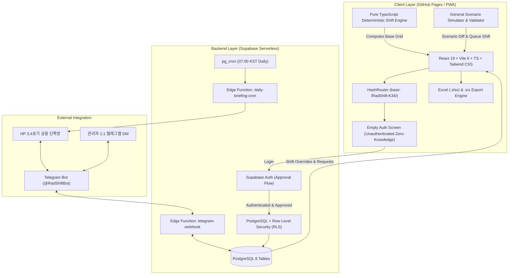
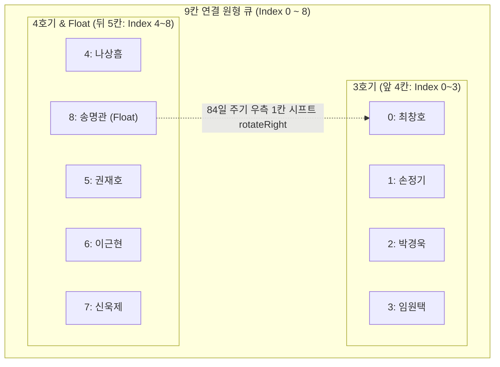
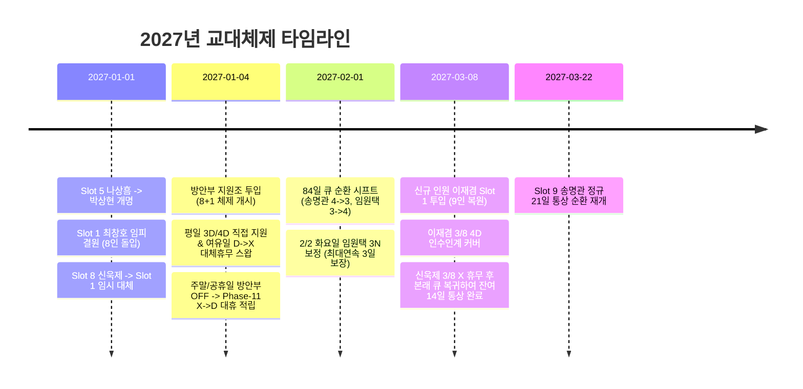
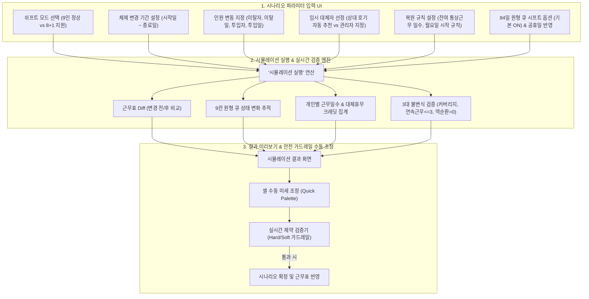

# RadShift_K34 프로그램 상세 명세서 (SRS & System Architecture)

**프로젝트명**: RadShift_K34  
**서비스명**: 한수원 HP 교대근무 관리 (고리 3,4호기)  
**문서 버전**: v1.1.0 (9칸 원형 큐 및 범용 관리자 시뮬레이터 구체화 개정본)  
**작성일**: 2026-11-25  
**원격 저장소**: [https://github.com/radshiftk34/RadShift-K34](https://github.com/radshiftk34/RadShift-K34)  
**대상 시스템**: 모바일 및 PC 호환형 웹앱(PWA), Supabase 서버리스 백엔드, 텔레그램 양방향 연동 봇

---

## 1. 시스템 개요 및 목적

한국수력원자력(한수원) 고리 3, 4호기 방사선관리(HP: Health Physics) 교대근무는 원자력 발전소의 특수 보안 시설 및 법정 방사선 방호 안전 규정에 부합하는 무결점 일일 커버리지를 엄격히 보장해야 합니다.
본 시스템은 **2026년 9인 정상 운영 체제(365일)** 및 **2027년 임금피크제(임피) 결원에 따른 8+1 방안부 지원 후 9인 원복 시나리오(365일)**, 나아가 향후 관리자가 입력하는 **임의의 인원 변동 및 시나리오**에서:

1. **일일 커버리지 불변식 오류 0건** (3호기 D/A/N 각 1명, 4호기 D/A/N 각 1명, 총 6명 근무 / 3명 휴무)
2. **전원 최대 연속근무 3일 이하 철저 준수**
3. **역순환(Quick Return: N/A/3N 직후 익일 D/3D/4D 투입) 0건**
4. **9칸 연결 원형 큐(Circular Queue) 기반 순번 및 84일 주기 우측 1칸 시프트 원칙**
을 수학적·결정론적으로 보장하는 규칙 엔진과 실시간 웹앱, 관리자 2-Layer 편집기, 범용 시뮬레이터, 텔레그램 봇 자동화 시스템을 제공합니다.

---

## 2. 기술 스택 및 배포·보안 아키텍처

### 2.1 프론트엔드 (GitHub Pages 정적 배포)
- **프레임워크**: React 19 + Vite 6 + TypeScript + Tailwind CSS (PWA 지원, 모바일 홈 화면 추가)
- **배포 설정**: `vite.config.ts`의 `base: '/RadShift-K34/'`, `HashRouter` 사용
- **엑셀 내보내기**: `xlsx` 라이브러리로 원본 양식 시트 3종(월별 가로 매트릭스 + 2026 vs 2027 비교표 + 크레딧 정산표) 다운로드 지원
- **캘린더 동기화**: 개인별 스마트폰 캘린더 연동용 `.ics` (iCalendar) 다운로드 지원
- **절대 보안 원칙**:
  - GitHub 저장소는 무료 플랜상 Public으로 배포되므로, 프론트엔드 소스코드·JSON·환경변수에 발전소 근무자 실명, 근무표 데이터, 텔레그램 봇 토큰, DB Service Role Key를 절대 하드코딩하지 않음.
  - 로그인 전에는 완전 빈 인증 화면(Login UI)만 렌더링.

### 2.2 백엔드 (Supabase 무료 티어)
- **Supabase Auth**: 이메일/비밀번호 로그인 + 관리자 승인제 (`status = 'pending'` $\rightarrow$ 관리자가 L1/L2/L3 권한 부여 후 `'approved'`로 변경)
- **PostgreSQL RLS (Row Level Security)**: DB 레벨에서 `auth.uid()`가 존재하고 `profiles.status = 'approved'`인 사용자만 데이터 조회 가능하도록 차단
- **Supabase Edge Functions (Deno/TypeScript)**:
  - `telegram-webhook`: 텔레그램 봇 명령어 및 인라인 버튼 콜백 처리 (토큰은 Supabase Secrets에만 보관)
  - `daily-briefing-cron`: 매일 오전 07:00(KST) 당일 교대조 브리핑 발송 (Supabase 7일 비활성 방지 겸용)
- **익명화 보안 모드**: 관리자 설정에서 '실명 표시 / 슬롯코드(HP-01~HP-09) 표시' 토글 지원

---

## 3. 핵심 교대근무 규칙 엔진 수학적 명세

### 3.1 기본 인원 및 일일 커버리지 불변식
- 총 9명: 3호기 교대조 4명 + 4호기 교대조 4명 + 통상 Day(Float) 1명.
- 일일 커버리지 불변식:
  - 3호기: D 1명, A 1명, N 1명
  - 4호기: D 1명, A 1명, N 1명
  - 총 6명 근무, 3명 휴무(X).
- 12일 개인 기본 교대 주기 배열 (인덱스 0~11):
  $$\text{CYCLE\_12} = [\text{D}, \text{D}, \text{X}, \text{A}, \text{A}, \text{A}, \text{X}, \text{N}, \text{N}, \text{N}, \text{X}, \text{X}]$$
- 기준일(Anchor Date): **2025-12-29 (월요일, $d = 0$)**
- 기준일($d = 0$) 초기 상태:
  - **3호기(4명)**: 박경욱(Phase 8), 임원택(Phase 11), 나상흠(Phase 2), 권재호(Phase 5) $\rightarrow d \pmod 3 == 0$인 날마다 3호기 주간 공백(3D) 발생.
  - **4호기(4명)**: 이근현(Phase 9), 신욱제(Phase 0), 최창호(Phase 3), 손정기(Phase 6) $\rightarrow d \pmod 3 == 2$인 날마다 4호기 주간 공백(4D) 발생.
  - **통상 Day(Float)**: 송명관 (기본 패턴: $d \pmod 3 == 0 \rightarrow \text{3D}$, $d \pmod 3 == 1 \rightarrow \text{X}$, $d \pmod 3 == 2 \rightarrow \text{4D}$).

---

### 3.2 9칸 연결 원형 큐(Circular Queue) 기반 순번 및 84일 우측 1칸 시프트 원칙

근무표의 행 위치와 순번은 단순한 고정 리스트가 아니라, **9칸 연결 원형 큐(Circular Queue)** 자료구조에 의해 결정됩니다.

1. **2026년 12월 말 기준 초기 원형 큐 상태 ($Q$)**:
   $$Q = [\text{0: 최창호}, \text{1: 손정기}, \text{2: 박경욱}, \text{3: 임원택} \mid \text{4: 나상흠}, \text{5: 권재호}, \text{6: 이근현}, \text{7: 신욱제}, \text{8: 송명관}]$$
2. **호기 배정 불변 원칙**:
   - 큐의 **앞 4칸(Index 0~3)**: **고리 3호기** 배정
   - 큐의 **뒤 5칸(Index 4~8)**: **고리 4호기(통상 Day 포함)** 배정
3. **84일 주기 연속 시프트 공식 ($\text{rotateRight}(Q, 1)$)**:
   매 84일(4회전·12주)이 경과할 때마다 큐 맨 뒤(Index 8)가 맨 앞(Index 0)으로 이동하며 전체 9칸이 오른쪽으로 1칸씩 순환 시프트됩니다.
   $$\text{rotateRight}(Q, 1) = [Q[8], Q[0], Q[1], Q[2], Q[3], Q[4], Q[5], Q[6], Q[7]]$$
   - **84일 경과 예시**:
     $$Q' = [\text{송명관}, \text{최창호}, \text{손정기}, \text{박경욱} \mid \text{임원택}, \text{나상흠}, \text{권재호}, \text{이근현}, \text{신욱제}]$$
     - 앞 4칸 `[송명관, 최창호(자리), 손정기, 박경욱]` = 3호기
     - 뒤 5칸 `[임원택, 나상흠(자리), 권재호, 이근현, 신욱제]` = 4호기
4. **표 행 위치 규칙**:
   - 근무표의 행 위치 자체가 현재 9칸 큐의 순번(Index 0~8)을 의미하며, 관리자의 명시적 변경 전까지는 84일 시프트 외에 임의로 변경되지 않습니다.
5. **임피(임금피크제) 결원·교체 및 원복 반영**:
   - 최창호·나상흠은 임피로 전환/이탈하는 인원입니다.
   - 2027-01-01: **박상현**은 나상흠 자리에 즉시 투입됩니다.
   - 2027-01-01: **최창호** 결원 시 **신욱제**가 상대 호기(4호기) 1순위로 3호기 최창호 자리를 임시 지원합니다.
   - 2027-03-08: 신규 인원 **이재겸**이 투입되면 최창호 자리로 들어가며, 임시 지원했던 신욱제는 본래 큐 순번인 `[이근현 -> 신욱제 -> 송명관]` 위치로 정확히 원복합니다.

---

### 3.3 21일(3주) 통상 Day 순환 및 일요일 경계일 조정 규칙
- 통상 Day는 항상 월요일 시작 ~ 3주 뒤 일요일 종료 (21일 블록).
- 순번은 9칸 큐 순서대로 순환 이동하며, 퇴장자는 진입자의 소속 호기와 위상을 그대로 승계함.
- **경계일(블록 20일차 일요일 / 21일차 월요일) 전이 규칙**:
  - **[유형 1: 차기 진입자가 4호기이고 $d \pmod 3 == 0$ 월요일 시작]**:
    - 교대 전날 일요일(블록 20일차): 진입자(당일 Phase 11, 원래 X)가 X $\rightarrow$ D로 전환하여 4호기 공백을 커버.
    - 퇴장자: 일요일 4D 면제되어 X-X(토·일 2일 휴무) 후 월요일 D-D로 복귀.
  - **[유형 2: 차기 진입자가 3호기이고 $d \pmod 3 == 0$ 월요일 시작]**:
    - 퇴장자: 일요일 4D까지 완료 후 월요일 X(1일 휴무), 화·수 D-D 복귀.
    - 진입자: 목~토 N-N-N, 일요일 X 후 월요일 3D로 순탄하게 진입.
  - **[유형 3: $d \pmod 3 == 1$ 월요일 시작 (예: 2027-03-22 이후)]**:
    - 월요일이 공백 없으므로 일요일 별도 조정 없이 진입자는 월요일 X, 화요일 4D, 수요일 3D로 역순환 없이 자연 진입.

---

### 3.4 84일 주기 HP 호기 이동 및 원형 큐 순환 시프트

- 정상 9인 체제에서 매 84일(4 x 21일)마다 4->3호기와 3->4호기 이동이 1명씩 교차 발생함.
  - 2026년 검증 일정: 3/2 손정기(4->3), 5/25 권재호(3->4), 8/17 최창호(4->3), 11/9 나상흠(3->4).
- **호기 이동 시 표 전체 행 순번 순환 시프트(Circular Right-Shift) 규칙**:
  - 4->3호기 이동자는 항상 **3호기 맨 위(1행)**로 배치.
  - 3->4호기 이동자는 항상 **4호기 맨 위(5행)**로 배치.
- **2027-02-01(월) 8인 체제 적용 결과**:
  - 1월: `[3호기: 신욱제, 손정기, 박경욱, 임원택 / 4호기: 박상현, 권재호, 이근현, 송명관]`
  - 2월: 송명관(4->3호기)과 임원택(3->4호기) 교차 이동 후 큐 순환 시프트 결과:
    $$Q_{\text{2027-02}} = [\text{3호기: 송명관, 신욱제, 손정기, 박경욱} \mid \text{4호기: 임원택, 박상현, 권재호, 이근현}]$$
  - 전환 익일(2/2 화요일): 송명관의 4연속 야간 방지를 위해 **송명관 X(휴무), 임원택 3N 1일 보정** 투입으로 전원 최대 연속근무 3일 이하 철저 보장.

---

### 3.5 2027년 확정 시나리오 타임라인 (8+1 방안부 지원 $\rightarrow$ 9인 복원)

- **방안부 지원조 일근 기준**:
  - 월~금 정상 평일 출근 / 토·일·법정공휴일·대체공휴일·근로자의날 무조건 OFF (X).
  - 평일 $d \pmod 3 == 0 \rightarrow \text{3D}$, $d \pmod 3 == 2 \rightarrow \text{4D}$.
  - 평일 $d \pmod 3 == 1$ (공백 없는 평일 여유일): 당일 D 예정 HP 2명 중 대체휴무 크레딧 보유자(최다 크레딧 우선, 동률 시 Phase 1 우선)에게 D $\rightarrow$ X 대체휴무(크레딧 -1)를 부여하고, 지원조가 `3D*` 또는 `4D*`로 대신 근무. 크레딧 보유자가 없으면 `일근` 표기.
  - 주말·공휴일(방안부 OFF) 공백: 해당 호기 Phase-11 근무자가 X $\rightarrow$ D 자동 투입 및 대체휴무 크레딧(+1) 적립.
- **2027년 대한민국 법정공휴일 및 대체공휴일 (총 24일 전수 수록)**:
  - 1/1(신정), 2/6~2/9(설날 연휴 및 대체공휴일 4일), 3/1(3·1절), 5/1~5/3(근로자의 날 및 대체공휴일 2일), 5/5(어린이날), 5/13(부처님오신날), 6/6(현충일), 7/17~7/19(제헌절 및 대체공휴일 2일), 8/15~8/16(광복절 및 대체공휴일 2일), 9/14~9/16(추석 연휴 3일), 10/3~10/4(개천절 및 대체공휴일 2일), 10/9~10/11(한글날 및 대체공휴일 2일), 12/25~12/27(성탄절 및 대체공휴일 2일).

---

## 4. 데이터베이스 스키마 명세 (Supabase PostgreSQL)

### 4.1 테이블 명세
1. `profiles`: 사용자 계정 및 권한 (`id`, `email`, `display_name`, `alias_code`, `role`, `status`, `slot_no`, `telegram_user_id`, `created_at`)
2. `rotation_slots`: 9개 슬롯 및 원형 큐 인원 매핑 (`slot_no`, `member_name`, `effective_from`, `effective_to`, `note`)
3. `scenarios`: 범용 시나리오 설정 (`id`, `name`, `mode`, `start_date`, `end_date`, `vacant_slot_no`, `temp_cover_slot_no`, `support_name`, `support_start_date`, `support_end_date`, `restore_remaining_days`, `enforce_84d_transfer`, `queue_state`, `is_active`, `created_at`)
4. `holidays`: 법정공휴일/대체공휴일 DB (`holiday_date`, `name`, `is_substitute`, `year`)
5. `leave_relief_requests`: 휴가 및 대근 신청서 (`id`, `target_date`, `unit_no`, `shift_code`, `requester_id`, `relief_id`, `leave_type`, `comp_type`, `status`, `telegram_message_id`, `approved_by`)
6. `shift_overrides`: 2-Layer 근무표 오버라이드 셀 (`id`, `target_date`, `slot_no`, `member_name`, `orig_code`, `new_code`, `badge_label`, `request_id`, `created_by`, `created_at`)
7. `credit_ledger`: 대체휴무 크레딧 원장 (`id`, `slot_no`, `target_date`, `credit_type`, `delta`, `memo`)
8. `audit_logs`: 관리자 수정 및 승인 감사 로그 (`id`, `actor_id`, `action_type`, `before_json`, `after_json`, `reason`, `created_at`)

### 4.2 Row Level Security (RLS) 정책
- 모든 테이블에 RLS 활성화.
- `auth.uid()` 인증 및 `profiles.status = 'approved'` 사용자만 SELECT 허용.
- 관리자 권한(`role = 'L3_ADMIN'`) 사용자만 INSERT/UPDATE/DELETE 허용.

---

## 5. 실시간 제약조건 검증기 및 범용 관리자 시뮬레이터 설계 명세

### 5.1 Hard Constraints (위반 시 저장 원천 차단)
1. 3호기(D,A,N) 및 4호기(D,A,N) 각 1명 미만 커버리지 부족.
2. 역순환(Quick Return): N/A/3N 근무 직후 익일 D/3D/4D 배정.
3. 1인 동일 일자 중복 근무 배정.
4. 방안부 일근 지원조의 주말/법정공휴일/대체공휴일 배정.

### 5.2 Soft Constraints (황색 경고 후 관리자 확인 시 허용)
1. 연속 근무 4일 이상 (`consecutive_days >= 4`).
2. 월간 개인별 근무일 편차 $\pm 2$일 초과 또는 미정산 크레딧 3일 초과.

### 5.3 대근자 Top 3 자동 추천 알고리즘
$$\text{Score} = 100 \times \text{IsPhase11} + 50 \times \text{SameUnit} - 10 \times \text{MonthlyShifts} - 20 \times \text{ReliefCount} - 5 \times \text{CreditBalance}$$
- Hard Filter: 당일 X 휴무자 중 투입 후 최대 연속근무 3일 이하 및 역순환이 발생하지 않는 후보자만 필터링 후 점수순 정렬.

---

### 5.4 [신규 구체화] 범용 관리자 시나리오 시뮬레이터 (General Scenario Simulator)

2027년 임피 시나리오는 시스템의 **기본 프리셋(Default Preset)**이며, 관리자는 향후 발생 가능한 다양한 결원·전보·휴직 상황을 임의로 설정하여 시뮬레이션 및 실제 운영에 적용할 수 있어야 합니다.

#### 1) 입력·선택 UI 파라미터 규격
1. **쉬프트 모드 선택**:
   - `NORMAL_9`: 9인 정상 운영 모드
   - `EIGHT_PLUS_DAYTIME`: 8+1 방안부 일근 지원 모드
2. **체제 변경 기간**:
   - 시작일(`start_date`), 종료일(`end_date`)
   - 8+1 모드 시: 지원인력 성명, 지원 시작일, 지원 종료일
3. **인원 변동 지정**:
   - 빠지는 인원 선택 (임피, 전보, 휴직, 파견 등) 및 이탈일
   - 새로 투입되는 인원 성명 및 투입일
4. **임시 대체자 선정**:
   - 기본 추천값: 결원 발생 호기의 상대 호기 소속 직원 중 `(1순위) 현재 통상 HP 근무자`, `(2순위) 상대 호기에서 가장 최근에 통상 HP를 근무한 직원` 자동 추천 (관리자가 타 직원으로 변경 가능).
   - 복원 시 처리: 원래 큐 순번으로 자동 복귀하며, 월요일 시작 원칙에 따른 잔여 통상근무 일수(기본 14일, 1~21일 가변 설정) 지정.
5. **부가 규칙 토글**:
   - `84일 원형 큐 시프트 적용 여부` (기본값 ON)
   - `법정공휴일/대체공휴일 DB 자동 반영 여부` (기본값 ON)

#### 2) 시뮬레이션 결과 미리보기(Diff) 및 규칙 준수 수동 미세 조정
1. **시뮬레이션 실행 결과 출력 항목**:
   - 변경 전/후 근무표 Diff 하이라이트 (교체 셀 강조 표시)
   - 9칸 원형 큐의 호기별 배치 및 시프트 상태 변화 시각화
   - 인원별 연간/월간 D·A·N·통상 근무일수 및 대체휴무 크레딧 변동 표
   - 3대 불변식 실시간 검증 결과 카드: 일일 커버리지 오류 수(목표 0건), 전원 최대 연속근무 일수(목표 3일 이하), 역순환 건수(목표 0건)
2. **규칙 가드레일 기반 수동 미세 조정 (Fine-tuning)**:
   - 시뮬레이션 결과 화면에서 관리자가 특정 일자·인원의 셀을 클릭하여 수동 조정 가능.
   - 수동 변경 시 실시간 제약조건 검증 엔진이 즉시 작동하여:
     - 호기별 D/A/N 각 1명 위반 시 즉시 에러 뱃지 표시
     - 역순환(N/A -> D) 발생 시 경고 및 저장 차단
     - 방안부 일근 지원조의 휴일 근무 배정 시 차단
     - 4연속 이상 근무 발생 시 주의 팝업 노출
   - 안전 가드레일을 통과한 건만 최종 승인하여 현업 근무표로 확정 반영할 수 있음.

---

## 6. 텔레그램 단톡방 양방향 연동 봇 명세

1. **계정 연동**: `/인증 [이름]` $\rightarrow$ 관리자 DM 승인 버튼 $\rightarrow$ `telegram_user_id` 매핑.
2. **단톡방 명령어**:
   - `/오늘`, `/내일`: 당일/익일 3·4호기 D/A/N, 통상Day, 지원조 현황 요약 카드 출력 + 인라인 버튼.
   - `/근무 [이름]`: 대상자 오늘 근무 및 향후 14일 근무표 출력.
   - `/월간 [YYYY-MM]`: 월간 통계 및 PWA 바로가기 링크.
   - `/비교`: 2026년 vs 2027년 개인별 근무일수 비교 요약.
   - `/대근요청 [YYYY-MM-DD] [사유]`: 당일 근무 조회 후 추천 Top 3 포함 대근 카드 발행.
     - `[제가 대근할게요]` 탭 $\rightarrow$ Edge Function 실시간 제약 검증 $\rightarrow$ 통과 시 관리자 승인 $\rightarrow$ 단톡방 확정 공지.
   - `/대근지정 [YYYY-MM-DD] [휴가자] [대근자]`: 관리자 직권 지정.
3. **자동 알림 스케줄러**:
   - 매일 07:00 (KST): 당일 근무 브리핑 단톡방 발송.
   - D-2 알림: 21일 통상 Day 교대 안내.
   - D-7 알림: 84일 호기 이동 대상자 사전 공지.
   - 실시간 알림: 대근 확정 및 관리자 근무표 수동 수정 시 Diff 공지.

---

## 7. 검증 및 테스트 계획

1. **단위 테스트 (Vitest 13개 테스트 전수 통과)**:
   - 2026년 365일 (2026-01-01 ~ 2026-12-31) 전수 시뮬레이션
   - 2027년 365일 (2027-01-01 ~ 2027-12-31) 8+1 및 복원 시나리오 전수 시뮬레이션
   - 일일 3호기(D,A,N=1), 4호기(D,A,N=1) 커버리지 100% 검증 (0건 오류)
   - 전원 최대 연속근무 $\le 3$일 검증
   - 역순환(N/A -> D) 0건 검증
   - 2027-02-01 84일 호기 이동 및 2/2 3N 보정 검증
   - 2027-03-08 이재겸 투입 및 신욱제 14일 잔여 통상근무 검증
2. **UI 및 반응형 테스트**: 모바일 뷰(375px~), 태블릿(768px~), PC 데스크톱(1280px~) 검증.
3. **CI/CD 테스트**: GitHub Actions를 통한 정적 빌드 및 GitHub Pages 배포 자동화.
